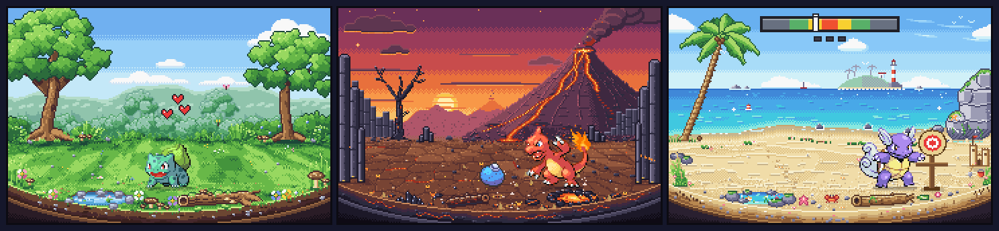
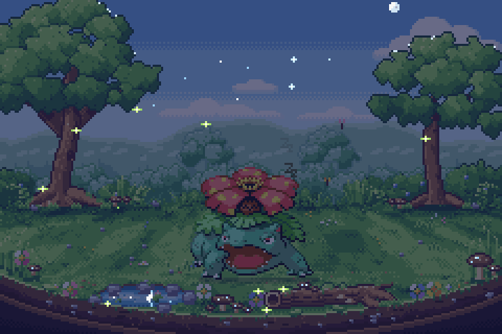
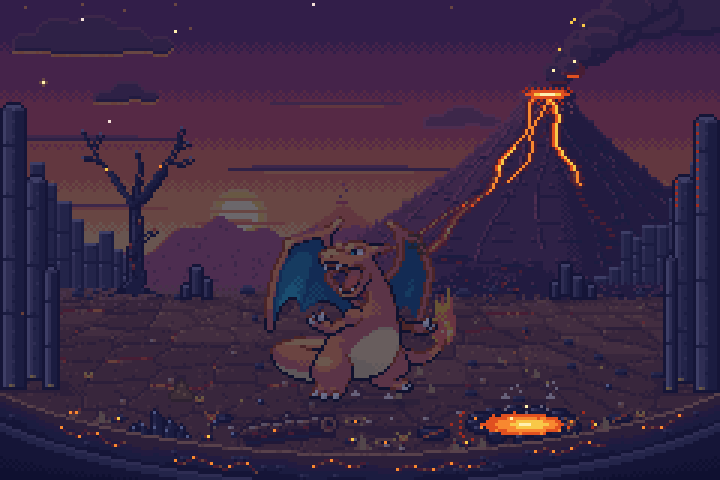
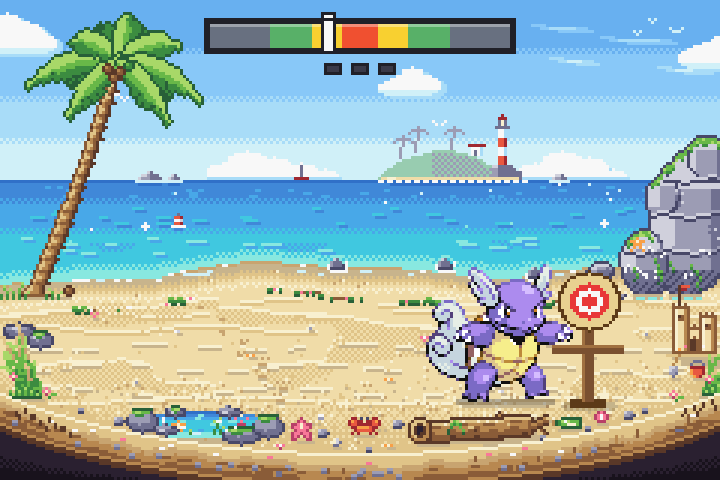
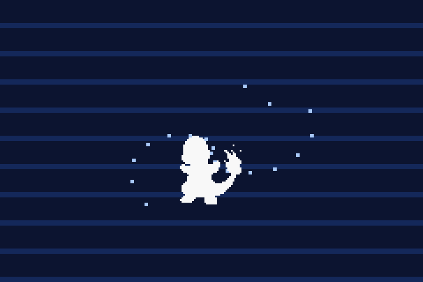

<div align="center">

# Pokégotchi

**Um mini universo Pokémon dentro da Pokébola.**<br>
Tamagotchi retrô no estilo *Pokémon FireRed/LeafGreen*, em um único arquivo HTML.




</div>

---

Escolha **Bulbasaur**, **Charmander** ou **Squirtle** e cuide dele dentro de uma Pokébola que é também um aparelhinho de bolso, o **POKé HABITAT**. Ele sente fome, sono e tédio, faz sujeira, fica doente se for esquecido, treina e evolui nos mesmos níveis do FireRed. Cada linha evolutiva vive no seu próprio diorama em pixel art: uma floresta, um vulcão ou uma praia. O cenário está sempre animado e, quando você apaga as luzes para ele dormir, acende a própria luz.

O tempo continua correndo com a aba fechada, até 12 horas. Quando você volta, o jogo calcula o que aconteceu enquanto você estava fora.

## Jogar

Não precisa instalar nada:

1. Baixe ou clone o repositório.
2. Abra o `index.html` no navegador.

Os sprites e o código já vêm dentro do arquivo. A internet só é usada para a fonte pixelada (Google Fonts) e o Tailwind (CDN). Sem conexão o jogo funciona do mesmo jeito, só que com a fonte monoespaçada do sistema.

Se preferir servir por HTTP:

```bash
php -S localhost:8000
```

## O que tem

- **Aparelho em forma de Pokébola**: tela no tamanho do GBA (240×160), caixa de diálogo e caixa de status no estilo do FireRed (com barras coloridas como as de PS), LED que pisca em vermelho quando ele está faminto ou doente, e botões no estilo START/SELECT.
- **Três habitats-diorama**: cada um tem dezenas de objetos, camadas de profundidade e uma base redonda com o corte do solo.
  - **Animação:** nuvens, borboletas, fumaça, ondas e um caranguejo.
  - **Luzes apagadas:** vaga-lumes, lava acesa, farol e a lua refletida no mar.
- **Cuidados de verdade**: fome, energia, felicidade e higiene mudam com o tempo; ele faz sujeira, adoece, dorme e acorda com fome.
- **Minigame de treino**: três golpes num boneco, acertando o tempo numa barra. Cansa e dá fome, mas faz evoluir bem mais rápido.
- **Evolução fiel ao FireRed**: nos níveis originais, com a animação de silhueta piscando, o flash branco e a fanfarra.
- **Sons 8-bit gerados na hora**: Web Audio API, sem nenhum arquivo de áudio.
- **Salvamento robusto**: o tempo é calculado pelo relógio. Recarregar ou deixar a aba em segundo plano não adianta nem atrasa o jogo, e duas abas abertas não contam o tempo em dobro.

<table>
  <tr>
    <td width="50%"></td>
    <td width="50%"></td>
  </tr>
  <tr>
    <td align="center"><sub>Com as luzes apagadas, a floresta acende vaga-lumes…</sub></td>
    <td align="center"><sub>…e o vulcão brilha.</sub></td>
  </tr>
</table>

## Controles

| Ação | Botão | Teclado | Toque |
|---|---|---|---|
| Alimentar (joga uma Fruta Oran) | **ALIMENTAR** | `F` | |
| Treinar | **TREINAR** | `T` | |
| Limpar o habitat | **LIMPAR** | `C` | toque numa sujeira para limpar só ela |
| Apagar / acender as luzes | **APAGAR** / **ACENDER** | `L` | |
| Carinho | botão central da Pokébola | `P` (ou `Espaço`, se nenhum botão estiver selecionado) | toque no Pokémon |
| Golpe (durante o treino) | **GOLPE!** ou botão central | `Espaço`, `P`, `T` ou `Enter` | toque em qualquer ponto da tela |
| Som liga/desliga | **SOM** | `M` | |
| Ficha do Pokémon (tipo, atributos base, contadores) | **DADOS** | | |
| Recomeçar com outro Pokémon | **RESET** (pede confirmação) | | |

## Como cuidar

### Os quatro status

Cada status vai de 0 a 100 e muda por minuto de jogo, que é o mesmo que um minuto real:

| Status | Cai com | Sobe com |
|---|---|---|
| **Fome** | 2/min acordado, 0,6/min dormindo. Dobra por 4 min depois que ele acorda (**FOME x2**). | Fruta: +30 |
| **Energia** | 1,2/min acordado. Doente, mais 0,5/min, acordado ou dormindo. | Dormir: +5/min (4,5/min se estiver doente) |
| **Felicidade** | 0,4/min sempre. Também: fome zerada −6, higiene < 30 −1,5, acordado há 10 min sem atenção −1, com sono −1, doente −1. | Carinho +6, comer +4, limpar +5 (mais +2 por sujeira), treinar +4 (só +1 se a média das notas ficar abaixo de BOM), evoluir +10 |
| **Higiene** | 0,4/min, mais 1,2/min por sujeira no chão | Limpar: volta a 100. Uma sujeira só: +12 |

As formas evoluídas são maiores: comem mais (fome cai ×1,15 e ×1,3), cansam menos acordadas (energia cai ×0,9 e ×0,8) e cada fruta rende um pouco menos (×0,9 e ×0,85).

### Sono

- Com energia abaixo de 15 ele fica **COM SONO**. Apague as luzes para ele dormir.
- Dormindo, recupera 5 de energia por minuto (4,5 se estiver doente). Com 100% ele acorda sozinho, mas só depois de pelo menos 3 minutos de sono.
- Se a energia zerar, ele cai no sono de exaustão.
- **Ao acordar, a fome dobra por 4 minutos.**

### Sujeira e doença

- Acordado, ele faz sujeira a cada 4 a 10 minutos, até 4 no chão. Depois de comer, a próxima vem em no máximo 1 a 3 minutos.
- Ele fica **DOENTE** se a higiene cair abaixo de 15, ou se a fome zerar com a felicidade abaixo de 25. Sara quando a higiene volta a 50 e a fome a 30.
- O selo **FAMINTO** aparece com fome abaixo de 20. Abaixo de 15, ou doente, o LED pisca vermelho e o aparelho apita a cada ~26 s (com a aba visível e o som ligado).

### Treino

O Pokémon vai até um boneco de treino e dá **3 golpes**. Em cada um, uma seta corre numa barra, cada vez mais rápido. Aperte **GOLPE!** quando ela estiver no vermelho:

<p align="center"></p>

| Nota | Zona da barra | Multiplicador de EXP |
|---|---|---|
| **CRÍTICO!** | 12% central (vermelho) | ×1,6 |
| **ÓTIMO!** | 32% central (amarelo) | ×1,25 |
| **BOM** | 60% central (verde) | ×1 |
| **FRACO** | bordas, ou sem resposta em 3,5 s | ×0,6 |

- **Ganho:** `(20 + 1,5 × nível) × média das notas` de EXP, e +20% se os três golpes forem CRÍTICO.
- **Custo:** −18 de energia, −12 de fome (×1,15 / ×1,3 nas evoluções) e −6 de higiene.
- **Quando dá para treinar:** acordado, sem estar doente, sem fruta no chão, com energia ≥ 20, fome ≥ 20 e felicidade ≥ 15.

Com energia e fome cheias, ele aguenta 5 treinos seguidos (energia 100 → 82 → 64 → 46 → 28 → 10) antes de ficar com sono.

### EXP e evolução

| Ação | EXP |
|---|---|
| Comer uma fruta | 8 + ⌊nível ÷ 2⌋ |
| Carinho (só conta se passar mais de 1,5 s desde o toque anterior) | 2 |
| Limpar o habitat | 4 + 3 por sujeira |
| Limpar uma sujeira com toque | 2 |
| Treino | veja acima |
| Bem cuidado (acordado, sem estar doente e os 4 status ≥ 50) | +2 por minuto, sozinho |

Para passar do nível *N* ao *N+1* são necessários `6 + 3 × N` de EXP. Isso dá 450 de EXP para chegar ao Nv. 16, 1.674 ao Nv. 32 e 2.100 ao Nv. 36.

| Linha | 1ª evolução | 2ª evolução | Habitat |
|---|---|---|---|
| Bulbasaur | Ivysaur no **Nv. 16** | Venusaur no **Nv. 32** | Floresta |
| Charmander | Charmeleon no **Nv. 16** | Charizard no **Nv. 36** | Vulcão |
| Squirtle | Wartortle no **Nv. 16** | Blastoise no **Nv. 36** | Praia |

Os níveis de evolução são os do FireRed/LeafGreen. A diferença é que aqui o inicial começa no Nv. 1, e não no Nv. 5. A evolução espera ele estar acordado e terminar o que está fazendo, como comer ou treinar.

<p align="center"></p>

## Salvamento

- O progresso fica no `localStorage` do navegador. É gravado a cada 2 segundos, ao esconder a aba e ao sair da página.
- **Nada depende do timer rodar.** Cada tick simula o tempo real desde o último tick registrado (que vai junto no save), em passos de até 10 s. Por isso recarregar a página, deixar a aba em segundo plano ou trocar de aba não adianta nem atrasa o jogo.
- **Fora do jogo** o tempo é simulado por no máximo 12 horas. Se você ficar mais tempo longe, conta como 12 h; ele não morre. Se passou mais de 1 minuto, na volta aparece um resumo, por exemplo: *"Você ficou fora 2h 13min. BULBASAUR fez 3 sujeiras."*
- **Duas abas abertas:** cada aba adota o save mais novo da outra. O tempo não conta em dobro, e uma evolução ou refeição não é aplicada duas vezes.
- **Save corrompido ou adulterado:** é validado campo a campo. O que não for número volta ao padrão, e estágio, nível (1–100), os quatro status (0–100), sujeiras e fruta são limitados à faixa válida. Se o save não puder ser aproveitado, o jogo volta para a escolha do inicial.

## Estrutura do projeto

```
pokegotchi/
├── index.html              ← o jogo pronto (gerado; é o arquivo que você abre)
├── README.md
├── LICENSE
├── src/
│   ├── game.html           ← HTML + CSS + JS do jogo (aparelho, lógica, sons, desenho)
│   ├── biomes/
│   │   ├── floresta.js     ← cenário de Bulbasaur/Ivysaur/Venusaur
│   │   ├── vulcao.js       ← cenário de Charmander/Charmeleon/Charizard
│   │   └── praia.js        ← cenário de Squirtle/Wartortle/Blastoise
│   └── sprites/            ← sprites FireRed/LeafGreen (1–9) e a Fruta Oran
├── tools/
│   ├── build.php           ← junta src/ em um único index.html
│   ├── bg-harness.html     ← bancada para desenhar e testar um bioma isolado
│   └── bgkit.js            ← helpers de pixel art usados pela bancada
└── docs/img/               ← capturas de tela usadas neste README
```

## Desenvolvimento

### Gerar o `index.html`

Depois de editar qualquer coisa em `src/`, rode (precisa do PHP 7.1 ou mais novo, de linha de comando):

```bash
php tools/build.php
```

O que o script faz:

1. Embute os sprites como *data URI* no lugar do marcador `/*SPRITES_JSON*/{}` de `src/game.html`.
2. Cola o código dos biomas no lugar de `/*BIOMES_JS*/`.
3. Envolve tudo num documento HTML completo.

Assim o `index.html` não depende de nenhum arquivo ao lado dele e funciona até em ambientes que bloqueiam imagens externas.

### Bancada de biomas

Para desenhar ou ajustar um cenário sem precisar jogar até ele, sirva a raiz do repositório e abra a bancada:

```bash
php -S localhost:8000
```

```
http://localhost:8000/tools/bg-harness.html?b=floresta&guide=1
```

| Parâmetro | Efeito |
|---|---|
| `b=floresta`, `b=vulcao` ou `b=praia` | escolhe o bioma |
| `t=7.5` | congela o tempo da animação nesse segundo |
| `night=1` | apaga as luzes (escuro + luz própria do bioma, atrás dos Pokémon, como no jogo) |
| `guide=1` | mostra a faixa onde o Pokémon anda, a linha dos pés (y = 134), a área da barra do treino e a borda do diorama |
| `pk=0` | esconde os três Pokémon de referência |

O rodapé da bancada mostra:

- o bioma, o `t` e se as luzes estão apagadas;
- quanto tempo o `bg()` levou para desenhar o cenário;
- quantas chamadas de `fillRect` o `anim()` faz por frame (e o `glow()`, com `night=1`);
- os erros capturados, ou "sem erros".

### Como é um bioma

Cada arquivo em `src/biomes/` registra três funções:

```js
BIOMES.floresta = (() => {
  // paleta e helpers privados ficam aqui dentro
  return {
    bg(c, rnd) { /* cenário estático: desenhado uma vez e guardado em cache */ },
    anim(c, t) { /* desenhado a cada frame, antes do Pokémon; t = segundos */ },
    glow(c, t) { /* só com as luzes apagadas: depois do escuro e antes do Pokémon, da fruta e das sujeiras */ },
  };
})();
```

Regras que mantêm o Pokémon com cara de estar pisando no chão:

- **Faixa livre:** o sprite pisa em `y = 134`, entre `x = 26` e `x = 214`. A faixa `x 20–220, y 100–134` fica livre de objetos altos.
- **Primeiro plano:** objetos baixos ficam na frente, de `y = 136` até a borda do diorama, `groundBottom(x)`.
- **Base:** perto do fim, o `bg()` chama `dioramaEdge(c, paleta)`, que desenha o corte do solo, o aro da base e o interior escuro da Pokébola. A paleta tem o formato `{ soil: [...], rim: [claro, médio, sombra], back: [superior, inferior] }`. Depois dele só entram detalhes no próprio corte do solo, como pedrinhas e veios.
- **Pixel art de verdade:** coordenadas inteiras, sem degradês nem transparência, e `anim` sem `Math.random`, para ser igual a cada `t`.

Os helpers (`R`, `disc`, `dither`, `rng`, `groundBottom`, `dioramaEdge`) e as constantes `W`, `H`, `FEET` e `EDGE` estão em `src/game.html`, com uma cópia idêntica em `tools/bgkit.js` para a bancada. Um bioma deve usar só o que existe no `bgkit.js`: no jogo ele enxerga todo o código do `game.html`, mas na bancada não.

## Créditos e aviso legal

Este é um **projeto de fã, sem fins comerciais e sem nenhuma ligação** com a Nintendo, a Creatures Inc., a GAME FREAK inc. ou a The Pokémon Company. Pokémon e todos os nomes e personagens relacionados são marcas registradas e © de seus respectivos donos.

- **Sprites:** sprites de *Pokémon FireRed/LeafGreen* e da Fruta Oran, obtidos do repositório [PokeAPI/sprites](https://github.com/PokeAPI/sprites).
- **Fontes:** [Press Start 2P](https://fonts.google.com/specimen/Press+Start+2P) e [VT323](https://fonts.google.com/specimen/VT323), via Google Fonts (SIL Open Font License).
- **CSS:** escrito à mão no próprio `game.html`. O [Tailwind CSS](https://tailwindcss.com) (CDN, v3.4.17) é carregado só pelo reset base; nenhuma classe utilitária é usada.
- **Cenários:** desenhados em código, pixel a pixel no canvas.
- **Interface:** HTML e CSS próprios, com ícones em pixel art gerados como SVG pelo código.
- **Sons:** sintetizados na hora com a Web Audio API.

## Licença

O código (`src/game.html`, `src/biomes/`, `tools/`) está sob a [licença MIT](LICENSE). Os sprites em `src/sprites/` (que o build também embute no `index.html`) e as marcas Pokémon não pertencem ao autor e **não** estão cobertos por ela; continuam pertencendo aos donos citados acima.
