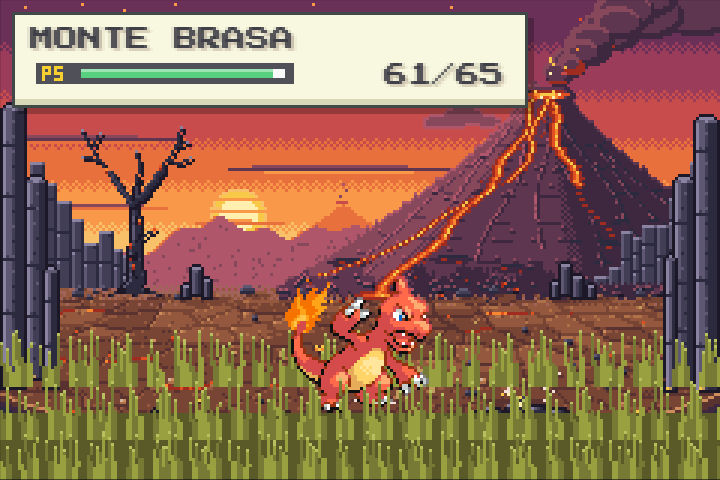
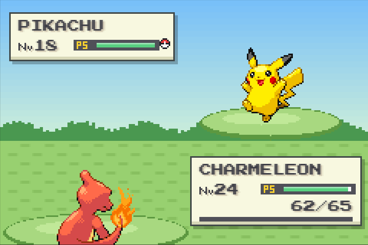
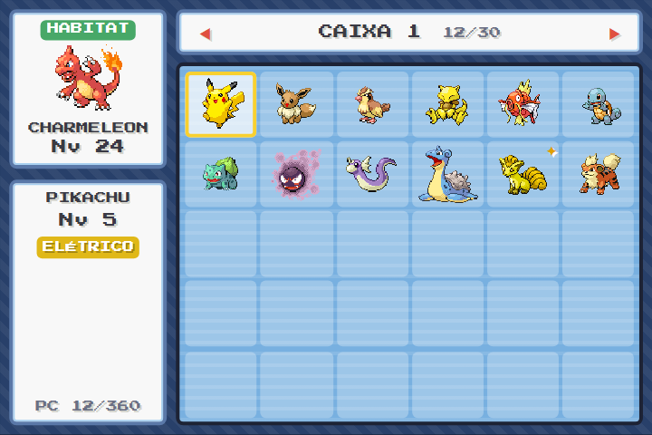
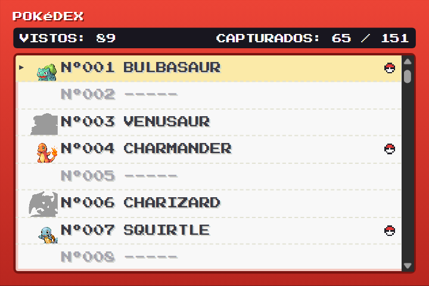

<div align="center">

# Pokégotchi

**Um mini universo Pokémon dentro da Pokébola.**<br>
Tamagotchi retrô no estilo *Pokémon FireRed/LeafGreen*, em um único arquivo HTML.


### [▶ Jogar agora](https://thomaslavruhin.github.io/pokegotchi/)


</div>

---

Escolha **Bulbasaur**, **Charmander** ou **Squirtle** e cuide dele dentro de uma Pokébola que é também um aparelhinho de bolso, o **POKé HABITAT**. Ele sente fome, sono e tédio, faz sujeira, fica doente se for esquecido, treina e evolui nos mesmos níveis do FireRed. Cada linha evolutiva vive no seu próprio diorama em pixel art: uma floresta, um vulcão ou uma praia. O cenário está sempre animado e, quando você apaga as luzes para ele dormir, acende a própria luz.

Quando ele estiver bem, saia para **explorar**: três áreas com grama alta, batalhas por turno no estilo do GBA e **todos os 151 Pokémon de Kanto** para capturar, dos mais comuns aos lendários. Cada captura vai para o **PC do Prof. Carvalho**, onde você pode trocar o Pokémon que mora no habitat. Complete a **Pokédex** para entrar no **Hall da Fama**.

O tempo continua correndo com a aba fechada, até 12 horas, e o dia e a noite seguem o relógio do aparelho. Quando você volta, o jogo calcula o que aconteceu enquanto você estava fora.

## Jogar

**Online:** abra **[thomaslavruhin.github.io/pokegotchi](https://thomaslavruhin.github.io/pokegotchi/)**. Funciona no computador e no celular, e o progresso fica salvo no seu navegador.

### Instalar como app

O Pokégotchi é um PWA. Instalado, ele abre na própria janela, sem barra de endereço, tem ícone de Pokébola e funciona **offline** depois da primeira visita.

- **Chrome ou Edge no computador:** clique no ícone de instalar na barra de endereço, ou no botão **INSTALAR** do próprio jogo.
- **Chrome no Android:** menu ⋮ → **Instalar app** (ou **Adicionar à tela inicial**), ou o botão **INSTALAR** do jogo.
- **Safari no iPhone/iPad:** botão Compartilhar → **Adicionar à Tela de Início**.

Quando sai uma versão nova, o app se atualiza sozinho na próxima vez que você abrir com internet. O progresso não se perde.

**No seu computador**, sem instalar nada:

1. Baixe ou clone o repositório.
2. Abra o `index.html` no navegador.

Sprites, fontes e código já vêm dentro do arquivo: o jogo não usa a internet para nada.

Se preferir servir por HTTP:

```bash
php -S localhost:8000
```

## O que tem

- **Aparelho em forma de Pokébola**: tela no tamanho do GBA (240×160), caixa de diálogo e caixa de status no estilo do FireRed (com barras coloridas como as de PS), LED que pisca em vermelho quando ele está faminto ou doente, e botões no estilo START/SELECT.
- **Três habitats-diorama**: cada um tem dezenas de objetos, camadas de profundidade e uma base redonda com o corte do solo.
  - **Animação:** nuvens, borboletas, fumaça, ondas e um caranguejo.
  - **Luzes apagadas:** vaga-lumes, lava acesa, farol e a lua refletida no mar.
- **Cuidados de verdade**: fome, energia, felicidade e higiene mudam com o tempo; ele faz sujeira, adoece, dorme e acorda com fome.
- **Aventura**: exploração, encontros selvagens, batalhas por turno e captura com POKé BOLA, GRANDE BOLA, ULTRA BOLA e BOLA MESTRA.
- **Os 151 de Kanto**: sprites e dados do FireRed/LeafGreen, versões **brilhantes** (1 em 512), lendários com regras próprias.
- **PC, BOLSA, POKéDEX e CARTÃO DE TREINADOR** no menu START, com 8 insígnias, medalhas e o Hall da Fama.
- **Dois minigames**: o treino (três golpes num boneco, acertando o tempo numa barra) e a **Colheita de Frutas**.
- **Evolução fiel ao FireRed**: por nível, por pedra e por troca, com a animação de silhueta piscando, o flash branco e a fanfarra.
- **Dia e noite de verdade**: amanhecer, dia, entardecer e noite pelo relógio do aparelho, mudando o cenário, o sono e os Pokémon que aparecem.
- **Sons 8-bit gerados na hora**: Web Audio API, sem nenhum arquivo de áudio.
- **Feito para qualquer tela**: o aparelho se ajusta para caber inteiro na janela, do celular pequeno ao monitor Full HD. Com o celular deitado, a Pokébola "deita" junto: tela à esquerda, botões à direita.
- **Instalável e offline**: vira um app com ícone próprio no computador e no celular.
- **Exportar e importar o save** como um código de texto, para levar o jogo para outro aparelho.
- **Salvamento robusto**: o tempo é calculado pelo relógio. Recarregar ou deixar a aba em segundo plano não adianta nem atrasa o jogo, e duas abas abertas não contam o tempo em dobro.

<table>
  <tr>
    <td width="50%"></td>
    <td width="50%"></td>
  </tr>
  <tr>
    <td align="center"><sub>Com as luzes apagadas, a floresta acende vaga-lumes…</sub></td>
    <td align="center"><sub>…e o vulcão brilha.</sub></td>
  </tr>
</table>

## Controles

| Ação | Botão | Teclado | Toque |
|---|---|---|---|
| Menu START (explorar, POKéDEX, POKéMON, BOLSA, PC, CARTÃO, OPÇÕES) | **MENU** | `Enter` | |
| Atalhos do menu | | `E` explorar · `D` POKéDEX · `I` BOLSA · `K` PC · `G` Colheita | |
| Nos menus e nas outras telas | os 4 botões redondos mudam de função (o nome aparece embaixo) | `1`–`4` apertam os botões; setas movem; `Z`/`Enter` confirma; `X`/`Esc` volta | toque no item |
| Alimentar (joga uma Fruta Oran) | **ALIMENTAR** | `F` | |
| Treinar | **TREINAR** | `T` | |
| Limpar o habitat | **LIMPAR** | `C` | toque numa sujeira para limpar só ela |
| Apagar / acender as luzes | **APAGAR** / **ACENDER** | `L` | |
| Carinho | botão central da Pokébola | `P` (ou `Espaço`, se nenhum botão estiver selecionado) | toque no Pokémon |
| Golpe (durante o treino) | **GOLPE!** ou botão central | `Espaço`, `P`, `T` ou `Enter` | toque em qualquer ponto da tela |
| Som liga/desliga | **SOM** | `M` | |
| Ficha do Pokémon (tipo, atributos base, contadores) | **DADOS** | | |
| Recomeçar com outro Pokémon | **MENU → OPÇÕES → RESET** (pede confirmação) | | |

## Como cuidar

### Os quatro status

Cada status vai de 0 a 100 e muda por minuto de jogo, que é o mesmo que um minuto real:

| Status | Cai com | Sobe com |
|---|---|---|
| **Fome** | 2/min acordado, 0,6/min dormindo. Dobra por 4 min depois que ele acorda (**FOME x2**). | Fruta: +30 |
| **Energia** | 1,2/min acordado. Doente, mais 0,5/min, acordado ou dormindo. | Dormir: +5/min (4,5/min se estiver doente) |
| **Felicidade** | 0,4/min sempre. Também: fome zerada −6, higiene < 30 −1,5, acordado há 10 min sem atenção −1, com sono −1, doente −1. | Carinho +6, comer +4, limpar +5 (mais +2 por sujeira), treinar +4 (só +1 se a média das notas ficar abaixo de BOM), evoluir +10 |
| **Higiene** | 0,4/min, mais 1,2/min por sujeira no chão | Limpar: volta a 100. Uma sujeira só: +12 |

As formas evoluídas são maiores: comem mais (fome cai ×1,15 e ×1,3), cansam menos acordadas (energia cai ×0,9 e ×0,8) e cada fruta rende um pouco menos (×0,9 e ×0,85).

### Sono

- Com energia abaixo de 15 ele fica **COM SONO**. Apague as luzes para ele dormir.
- Dormindo, recupera 5 de energia por minuto (4,5 se estiver doente). Com 100% ele acorda sozinho, mas só depois de pelo menos 3 minutos de sono.
- Se a energia zerar, ele cai no sono de exaustão.
- **Ao acordar, a fome dobra por 4 minutos.**

### Sujeira e doença

- Acordado, ele faz sujeira a cada 4 a 10 minutos, até 4 no chão. Depois de comer, a próxima vem em no máximo 1 a 3 minutos.
- Ele fica **DOENTE** se a higiene cair abaixo de 15, ou se a fome zerar com a felicidade abaixo de 25. Sara quando a higiene volta a 50 e a fome a 30.
- O selo **FAMINTO** aparece com fome abaixo de 20. Abaixo de 15, ou doente, o LED pisca vermelho e o aparelho apita a cada ~26 s (com a aba visível e o som ligado).

### Treino

O Pokémon vai até um boneco de treino e dá **3 golpes**. Em cada um, uma seta corre numa barra, cada vez mais rápido. Aperte **GOLPE!** quando ela estiver no vermelho:

<p align="center"></p>

| Nota | Zona da barra | Multiplicador de EXP |
|---|---|---|
| **CRÍTICO!** | 12% central (vermelho) | ×1,6 |
| **ÓTIMO!** | 32% central (amarelo) | ×1,25 |
| **BOM** | 60% central (verde) | ×1 |
| **FRACO** | bordas, ou sem resposta em 3,5 s | ×0,6 |

- **Ganho:** `(20 + 1,5 × nível) × média das notas` de EXP, e +20% se os três golpes forem CRÍTICO.
- **Custo:** −18 de energia, −12 de fome (×1,15 / ×1,3 nas evoluções) e −6 de higiene.
- **Quando dá para treinar:** acordado, sem estar doente, sem fruta no chão, com energia ≥ 20, fome ≥ 20 e felicidade ≥ 15.

Com energia e fome cheias, ele aguenta 5 treinos seguidos (energia 100 → 82 → 64 → 46 → 28 → 10) antes de ficar com sono.

### EXP e evolução

| Ação | EXP |
|---|---|
| Comer uma fruta | 8 + ⌊nível ÷ 2⌋ |
| Carinho (só conta se passar mais de 1,5 s desde o toque anterior) | 2 |
| Limpar o habitat | 4 + 3 por sujeira |
| Limpar uma sujeira com toque | 2 |
| Treino | veja acima |
| Bem cuidado (acordado, sem estar doente e os 4 status ≥ 50) | +2 por minuto, sozinho |

Para passar do nível *N* ao *N+1* são necessários `6 + 3 × N` de EXP. Isso dá 450 de EXP para chegar ao Nv. 16, 1.674 ao Nv. 32 e 2.100 ao Nv. 36.

| Linha | 1ª evolução | 2ª evolução | Habitat |
|---|---|---|---|
| Bulbasaur | Ivysaur no **Nv. 16** | Venusaur no **Nv. 32** | Floresta |
| Charmander | Charmeleon no **Nv. 16** | Charizard no **Nv. 36** | Vulcão |
| Squirtle | Wartortle no **Nv. 16** | Blastoise no **Nv. 36** | Praia |

Os outros Pokémon seguem as mesmas regras do FireRed: evoluem por nível, por **pedra** (use na BOLSA) ou por **troca** (o PC troca com um amigo, gastando um CABO DE TROCA). Na tela de evolução, `X` ou `Esc` cancela, e ele espera o próximo nível para tentar de novo.

Os níveis de evolução são os do FireRed/LeafGreen. A diferença é que aqui o inicial começa no Nv. 1, e não no Nv. 5. A evolução espera ele estar acordado e terminar o que está fazendo, como comer ou treinar.

<p align="center"></p>

## Aventura

### Explorar

No menu START, **EXPLORAR** leva o Pokémon do habitat para uma das três áreas:

| Área | Cenário | Quem aparece mais |
|---|---|---|
| FLORESTA DE VIRIDIAN | floresta | grama, inseto, voador, veneno, normal, psíquico |
| MONTE BRASA | vulcão | fogo, pedra, terra, lutador, elétrico, fantasma |
| ILHAS ESPUMA | praia | água, gelo, dragão |

- Cada passo (**ANDAR**) leva 3 s e gasta energia, fome e higiene. Em 85% das vezes aparece um Pokémon selvagem; nos outros, um item (bolas, poções, pedras, fósseis).
- Para sair e para cada passo ele precisa estar acordado, saudável, com energia ≥ 25, fome ≥ 20 e felicidade ≥ 15. Se cair abaixo disso, ele volta para casa sozinho.
- O PS da saída depende da energia e vai caindo de batalha em batalha; a POÇÃO recupera. Em casa ele volta cheio.

<table>
  <tr>
    <td width="50%"></td>
    <td width="50%"></td>
  </tr>
  <tr>
    <td align="center"><sub>Grama alta no Monte Brasa…</sub></td>
    <td align="center"><sub>…e um Pikachu selvagem.</sub></td>
  </tr>
</table>

### Batalha e captura

Batalha por turno com as contas da 3ª geração: atributos, tipos, golpe físico ou especial, crítico e bônus de mesmo tipo. Os golpes vêm do tipo do Pokémon e chegam nos níveis 10, 22 e 38.

| Botão | O que faz |
|---|---|
| **LUTAR** | mostra os golpes nos 4 botões |
| **BOLSA** | joga uma bola ou usa uma POÇÃO |
| **ANIMAR** | uma vez por batalha: +felicidade e mais chance de crítico |
| **FUGIR** | volta para a grama |

- O cuidado conta na luta: com fome ele bate mais fraco; triste, às vezes emburra; muito feliz, acerta mais críticos e aguenta um golpe que o derrubaria.
- A captura usa a fórmula do jogo: PS baixo, bola melhor e o selvagem dormindo ajudam. *"Parabéns! [Nome] foi pego!"*, e ele vai para o PC.
- Raridade: **comum, incomum, raro e muito raro**, conforme a taxa de captura. Os raros aparecem a partir da 1ª insígnia, os muito raros a partir da 3ª. Uma espécie que você ainda não tem aparece 3 vezes mais, e depois de 7 encontros sem novidade vem com certeza uma nova.
- **Lendários:** cada insígnia de 5 a 8 espalha um boato. ARTICUNO, ZAPDOS e MOLTRES aparecem raramente na sua área; MEWTWO, só à noite; MEW, só depois do MEWTWO. Um lendário que foge guarda o PS e volta no dia seguinte.

### PC, BOLSA e POKéDEX

- **PC do Prof. Carvalho:** 12 caixas de 30. **ATIVAR** troca o Pokémon do habitat (com o habitat limpo e no máximo uma vez a cada 30 min); cada um guarda seus próprios status. Também tem DADOS, USAR ITEM, TROCAR e SOLTAR (que devolve uma bola).
- **BOLSA:** DOCE RARO (+1 nível), pedras de evolução (só as que funcionam no Pokémon aparecem ativas; o EEVEE escolhe a forma pela pedra) e fósseis, que o professor revive.
- **POKéDEX:** não vistos ficam escondidos (`-----`), vistos aparecem em silhueta, capturados em cores, com a contagem **CAPTURADOS: N / 151**. A ficha mostra tipos, altura, peso, atributos, área e evoluções.
<table>
  <tr>
    <td width="50%"></td>
    <td width="50%"></td>
  </tr>
  <tr>
    <td align="center"><sub>O PC do Prof. Carvalho…</sub></td>
    <td align="center"><sub>…e a Pokédex, com vistos em silhueta.</sub></td>
  </tr>
</table>

- **Hall da Fama:** ao capturar o 151º, o time desfila, os 151 passam como créditos e você ganha o **DIPLOMA** e o **AMULETO BRILHANTE** (brilhantes 2× mais comuns). Dá para rever no CARTÃO.

### Insígnias

| Insígnia | Exige | Prêmio |
|---|---|---|
| ROCHA | 10 capturados | 10 POKé BOLAS; aparecem os raros |
| CASCATA | 25 capturados e 3 dias bem cuidados | 5 GRANDES BOLAS, PEDRA DA ÁGUA, um inicial de presente |
| TROVÃO | 40 capturados e 15 vitórias | PEDRA DO TROVÃO, CABO DE TROCA, fóssil; aparecem os muito raros |
| ARCO-ÍRIS | 55 capturados e 200 pontos na Colheita | PEDRA DA FOLHA, 3 ULTRA BOLAS, fóssil, o outro inicial |
| ALMA | 70 capturados e 1 evolução por pedra ou troca | PEDRA DA LUA, 2 CABOS; boato do ARTICUNO |
| PÂNTANO | 85 capturados e um Pokémon no Nv. 30 | PEDRA DO FOGO, fóssil; boato do ZAPDOS |
| VULCÃO | 100 capturados e 10 capturas à noite | PEDRA DA LUA, CABO, 5 ULTRA BOLAS; boato do MOLTRES |
| TERRA | 120 capturados e os 3 pássaros | BOLA MESTRA; boato do MEWTWO |

Medalhas extras (BRILHO, VETERANO, FIEL, MESTRE DO TREINO, COLHEDOR, PALEONTÓLOGO, NEGOCIANTE, CAÇADOR DE LENDAS, MESTRE POKéMON) aparecem no CARTÃO.

**Bolas:** o Prof. Carvalho manda 5 POKé BOLAS por dia (mais GRANDES e ULTRA com as insígnias, e um bônus a cada 7 dias seguidos), 1 bola por hora de Pokémon bem cuidado (até 4 por dia) e 5 de emergência quando você fica com menos de 3.

### Dia e noite

| Fase | Horário |
|---|---|
| AMANHECER | 5:00–6:59 |
| DIA | 7:00–17:59 |
| ENTARDECER | 18:00–19:29 |
| NOITE | 19:30–4:59 |

À noite o cenário escurece, ele cansa mais rápido, fica com sono mais cedo, dorme melhor e pode adormecer sozinho. Acordar no amanhecer deixa ele mais feliz. Os Pokémon noturnos (Zubat, Gastly, Meowth…) aparecem mais à noite, e os pássaros e insetos, de dia.

### Colheita de Frutas

O segundo minigame, no botão **TREINAR** (ou `G`). Por 30 s, ele corre de um lado para o outro pegando frutas que caem: FRUTA ORAN (+10), FRUTA SITRUS (+25) e POKé BOLAS de verdade, fugindo das pedras. Cinco seguidas ativam o combo ×1,5. Dá EXP e felicidade; nas 5 primeiras partidas do dia, também bolas (até 4 por dia) e, com 350 pontos, chance de uma pedra.

Controles: segure o lado esquerdo ou direito da tela, ou use `←`/`→` (ou `A`/`D`); `P` pausa e `Esc` sai.

## Salvamento

- O progresso fica no `localStorage` do navegador. É gravado a cada 2 segundos, ao esconder a aba e ao sair da página.
- **Nada depende do timer rodar.** Cada tick simula o tempo real desde o último tick registrado (que vai junto no save), em passos de até 10 s. Por isso recarregar a página, deixar a aba em segundo plano ou trocar de aba não adianta nem atrasa o jogo.
- **Fora do jogo** o tempo é simulado por no máximo 12 horas. Se você ficar mais tempo longe, conta como 12 h; ele não morre. Se passou mais de 1 minuto, na volta aparece um resumo, por exemplo: *"Você ficou fora 2h 13min. BULBASAUR fez 3 sujeiras."*
- **Duas abas abertas:** cada aba adota o save mais novo da outra. O tempo não conta em dobro, e uma evolução ou refeição não é aplicada duas vezes.
- **Exportar e importar:** em **MENU → OPÇÕES**, **EXPORTAR** gera um código de texto (compactado e com verificação) para copiar ou compartilhar; **IMPORTAR** cola esse código em outro aparelho, mostra um resumo e pede confirmação. O jogo anterior fica guardado e **DESFAZER IMPORTAÇÃO** volta para ele.
- **Saves antigos** (só com o inicial) são convertidos sozinhos para o formato novo, e o antigo fica guardado.
- **Save corrompido ou adulterado:** é validado campo a campo. O que não for número volta ao padrão, e estágio, nível (1–100), os quatro status (0–100), sujeiras e fruta são limitados à faixa válida. Se o save não puder ser aproveitado, o jogo volta para a escolha do inicial.

## Estrutura do projeto

```
pokegotchi/
├── index.html              ← o jogo pronto (gerado; é o arquivo que você abre e o que o GitHub Pages publica)
├── sw.js                   ← service worker (gerado): instalação e modo offline
├── manifest.webmanifest    ← nome, ícones e cores do app instalado
├── icons/                  ← ícones do app (gerados por tools/make-icons.php)
├── .nojekyll               ← faz o GitHub Pages servir os arquivos como estão
├── README.md
├── LICENSE
├── src/
│   ├── game.html           ← núcleo: aparelho, cuidados, save, menus, sons, desenho
│   ├── sw.js               ← modelo do service worker (o build carimba a versão)
│   ├── modules/            ← a aventura, um módulo por tela (contrato em docs/MODULOS.md)
│   │   ├── explore.js      ← áreas, grama alta e sorteio de encontros
│   │   ├── battle.js/.css  ← batalha por turno e captura
│   │   ├── bag.js/.css     ← BOLSA de casa
│   │   ├── pc.js/.css      ← PC do Prof. Carvalho
│   │   ├── pokedex.js/.css ← POKéDEX
│   │   ├── card.js/.css    ← CARTÃO DE TREINADOR
│   │   ├── hall.js         ← Hall da Fama e diploma
│   │   ├── progress.js     ← insígnias, medalhas e presentes
│   │   ├── options.js/.css ← exportar e importar o save
│   │   └── colheita.js     ← minigame Colheita de Frutas
│   ├── data/
│   │   ├── dex.js          ← os 151: tipos, atributos, captura, evoluções (gerado por tools/make-dex.js)
│   │   └── shiny.js        ← paletas dos brilhantes (gerado por tools/make-shiny.js)
│   ├── biomes/
│   │   ├── floresta.js     ← cenário de Bulbasaur/Ivysaur/Venusaur
│   │   ├── vulcao.js       ← cenário de Charmander/Charmeleon/Charizard
│   │   └── praia.js        ← cenário de Squirtle/Wartortle/Blastoise
│   ├── sprites/            ← sprites FireRed/LeafGreen de frente e de costas (1–151) e a Fruta Oran
│   └── fonts/              ← Press Start 2P e VT323 (subconjunto latino, .woff2) e suas licenças OFL
├── tools/
│   ├── build.php           ← junta src/ em um único index.html e gera o sw.js
│   ├── fetch-sprites.js    ← baixa os sprites do PokeAPI/sprites (Node, só para desenvolver)
│   ├── make-dex.js         ← gera src/data/dex.js a partir da PokéAPI
│   ├── make-shiny.js       ← extrai as paletas brilhantes
│   ├── make-icons.php      ← desenha os ícones (Pokébola em pixel art) sem depender de GD
│   ├── bg-harness.html     ← bancada para desenhar e testar um bioma isolado
│   └── bgkit.js            ← helpers de pixel art usados pela bancada
└── docs/
    ├── MODULOS.md          ← como escrever um módulo: estado, funções do núcleo, ganchos
    └── img/                ← capturas de tela usadas neste README
```

## Desenvolvimento

### Gerar o `index.html`

Depois de editar qualquer coisa em `src/`, rode (precisa do PHP 7.1 ou mais novo, de linha de comando):

```bash
php tools/build.php
```

O que o script faz:

1. Embute os sprites (frente e costas dos 151, e a fruta) como *data URI* no lugar do marcador `/*SPRITES_JSON*/{}` de `src/game.html`. Os brilhantes não são embutidos: o jogo troca a paleta do PNG na hora.
2. Cola os dados (`src/data/`) em `/*DATA_JS*/`, os biomas em `/*BIOMES_JS*/` e os módulos (`src/modules/*.js` e `*.css`, em ordem alfabética) em `/*MODULES_JS*/` e `/*MODULES_CSS*/`.
3. Embute as fontes de `src/fonts/` como `@font-face` em *data URI* no lugar de `/*FONTS_CSS*/`.
4. Envolve tudo num documento HTML completo, com o cabeçalho do app (manifest, ícones, registro do service worker).
5. Gera o `sw.js` a partir de `src/sw.js`, com a versão igual a um hash do `index.html`. Cada publicação nova cria um cache novo e apaga o antigo.

Os sprites e os dados só precisam ser baixados de novo se você quiser regenerá-los (`node tools/fetch-sprites.js`, `node tools/make-dex.js`, `node tools/make-shiny.js`); o jogo em si nunca acessa a internet.

Para testar pelo console, abra o jogo com `#dev` no endereço (`index.html#dev`): `window.PKG` expõe o estado e as funções principais.

Assim o `index.html` não depende de nenhum arquivo ao lado dele para rodar e funciona até em ambientes que bloqueiam imagens e fontes externas. Os ícones só mudam se você rodar `php tools/make-icons.php`.

### Bancada de biomas

Para desenhar ou ajustar um cenário sem precisar jogar até ele, sirva a raiz do repositório e abra a bancada:

```bash
php -S localhost:8000
```

```
http://localhost:8000/tools/bg-harness.html?b=floresta&guide=1
```

| Parâmetro | Efeito |
|---|---|
| `b=floresta`, `b=vulcao` ou `b=praia` | escolhe o bioma |
| `t=7.5` | congela o tempo da animação nesse segundo |
| `night=1` | apaga as luzes (escuro + luz própria do bioma, atrás dos Pokémon, como no jogo) |
| `guide=1` | mostra a faixa onde o Pokémon anda, a linha dos pés (y = 134), a área da barra do treino e a borda do diorama |
| `pk=0` | esconde os três Pokémon de referência |

O rodapé da bancada mostra:

- o bioma, o `t` e se as luzes estão apagadas;
- quanto tempo o `bg()` levou para desenhar o cenário;
- quantas chamadas de `fillRect` o `anim()` faz por frame (e o `glow()`, com `night=1`);
- os erros capturados, ou "sem erros".

### Como é um bioma

Cada arquivo em `src/biomes/` registra três funções:

```js
BIOMES.floresta = (() => {
  // paleta e helpers privados ficam aqui dentro
  return {
    bg(c, rnd) { /* cenário estático: desenhado uma vez e guardado em cache */ },
    anim(c, t) { /* desenhado a cada frame, antes do Pokémon; t = segundos */ },
    glow(c, t) { /* só com as luzes apagadas: depois do escuro e antes do Pokémon, da fruta e das sujeiras */ },
  };
})();
```

Regras que mantêm o Pokémon com cara de estar pisando no chão:

- **Faixa livre:** o sprite pisa em `y = 134`, entre `x = 26` e `x = 214`. A faixa `x 20–220, y 100–134` fica livre de objetos altos.
- **Primeiro plano:** objetos baixos ficam na frente, de `y = 136` até a borda do diorama, `groundBottom(x)`.
- **Base:** perto do fim, o `bg()` chama `dioramaEdge(c, paleta)`, que desenha o corte do solo, o aro da base e o interior escuro da Pokébola. A paleta tem o formato `{ soil: [...], rim: [claro, médio, sombra], back: [superior, inferior] }`. Depois dele só entram detalhes no próprio corte do solo, como pedrinhas e veios.
- **Pixel art de verdade:** coordenadas inteiras, sem degradês nem transparência, e `anim` sem `Math.random`, para ser igual a cada `t`.

Os helpers (`R`, `disc`, `dither`, `rng`, `groundBottom`, `dioramaEdge`) e as constantes `W`, `H`, `FEET` e `EDGE` estão em `src/game.html`, com uma cópia idêntica em `tools/bgkit.js` para a bancada. Um bioma deve usar só o que existe no `bgkit.js`: no jogo ele enxerga todo o código do `game.html`, mas na bancada não.

## Créditos e aviso legal

Este é um **projeto de fã, sem fins comerciais e sem nenhuma ligação** com a Nintendo, a Creatures Inc., a GAME FREAK inc. ou a The Pokémon Company. Pokémon e todos os nomes e personagens relacionados são marcas registradas e © de seus respectivos donos.

- **Sprites:** sprites de *Pokémon FireRed/LeafGreen* e da Fruta Oran, obtidos do repositório [PokeAPI/sprites](https://github.com/PokeAPI/sprites).
- **Dados dos Pokémon:** tipos, atributos, taxas de captura e evoluções da 3ª geração, da [PokéAPI](https://pokeapi.co/).
- **Fontes:** [Press Start 2P](https://fonts.google.com/specimen/Press+Start+2P) e [VT323](https://fonts.google.com/specimen/VT323), embutidas no jogo sob a SIL Open Font License (textos da licença em `src/fonts/`).
- **CSS:** escrito à mão no próprio `game.html`, com um reset mínimo no topo. Nenhum framework.
- **Cenários:** desenhados em código, pixel a pixel no canvas.
- **Interface:** HTML e CSS próprios, com ícones em pixel art gerados como SVG pelo código.
- **Sons:** sintetizados na hora com a Web Audio API.

## Licença

O código (`src/game.html`, `src/modules/`, `src/biomes/`, `tools/`) está sob a [licença MIT](LICENSE). Os sprites em `src/sprites/` (que o build também embute no `index.html`) e as marcas Pokémon não pertencem ao autor e **não** estão cobertos por ela; continuam pertencendo aos donos citados acima.
